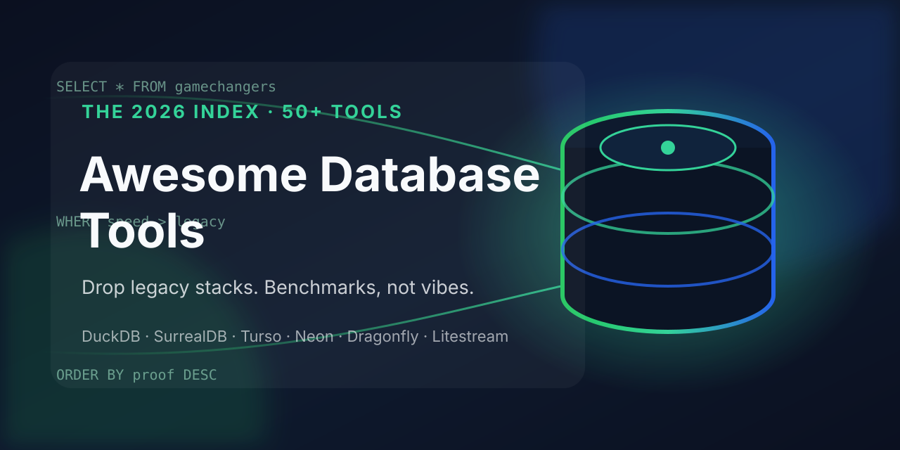

<p align="center">
  
</p>

# 🗄️ Awesome Database Tools 2026

> **Drop legacy stacks. Benchmarks, not vibes.**
> Curated from 137K+ GitHub repos · live-verified against the GitHub API · October 2026

[](https://awesome.re)
[](#-decision-matrix)
[](#-agent-query-api)
[](../../compare)
[](.)

---

## 💥 WTF is this?

The database toolchain you learned in 2015 is not the one you'd pick today.
This list tells you what **actually replaced it** — with proof, not star counts alone.

> **Real example:** [Tailscale] runs production infrastructure on **SQLite + [Litestream]**. Not as a toy — as their control-plane store, with point-in-time restore to S3. The "SQLite can't do production" assumption died years ago; most teams just haven't noticed.

> **Another one:** [Timescale] benchmarked [pgvectorscale] (pgvector + DiskANN) against **Pinecone** on 50M vectors — Postgres matched or beat it, and your vectors live **next to your data**. One system less to run.

> **And this one:** [Dragonfly] is a drop-in replacement for Redis that does **~25× the throughput** on a single node. Teams are replacing entire Redis *clusters* with one instance.

Every entry here has a story like that. Let's go.

---

## ⚡ TL;DR — Top 10 Drops Right Now

| Drop this | Use this instead | Real gain |
|-----------|-----------------|-----------|
| `pgAdmin` / `phpMyAdmin` | [DbGate] · [Harlequin] | modern UI · TUI built for AI agents (`hsql`) |
| `Redis` (single-purpose) | [Dragonfly] | ~25× throughput · drop-in protocol · one node replaces a cluster |
| `pg_dump` cron backups | [Litestream] | streaming replication to S3 · point-in-time restore · seconds of data loss |
| Hand-edited `migration.sql` | [Atlas] or [pgroll] | declarative schema-as-code · **zero-downtime** expand/contract |
| `Mongo + Postgres + Redis` | [SurrealDB] | one binary: doc + graph + SQL + vector + live queries |
| `Elasticsearch` (app search) | [ParadeDB] | BM25 + vectors *inside* Postgres — delete a whole system |
| `Pinecone` | [pgvector] + [pgvectorscale] · [Qdrant] · [LanceDB] | vector index inside/next to your DB · no second system of record |
| `BigQuery`/`Spark` (&lt;1TB) | [DuckDB] | in-process OLAP · zero infra · joins Parquet/CSV/Postgres in one query |
| `Debezium + Kafka` (simple sync) | [Electric] · [Sequin] · [PeerDB] | Postgres CDC → streams/clients without the Kafka tax |
| "SQLite can't replicate" | [Turso] · [Litestream] | libSQL fork · edge replicas · embedded replicas in-app |

---

## Contents

| Category | Quick pick |
|----------|-----------|
| [💥 AHA Moments](#-aha-moments-real-world-impact) | Before/after stories |
| [🖥️ SQL Clients & IDEs](#-sql-clients--ides) | DbGate · Beekeeper · Harlequin · usql |
| [🧬 Migrations & Schema Governance](#-migrations--schema-governance) | Atlas · pgroll · Bytebase · sqlfluff |
| [🆕 New-Gen Engines](#-new-gen-engines) | DuckDB · SurrealDB · Turso · Neon · Dolt |
| [🐘 Postgres Superpowers](#-postgres-superpowers) | Supabase · pgvector · ParadeDB · TimescaleDB |
| [🔍 Search & Vector](#-search--vector) | ParadeDB · Qdrant · LanceDB · pgvectorscale |
| [⚡ Cache & Query Acceleration](#-cache--query-acceleration) | Dragonfly · Valkey · ReadySet |
| [🔄 Replication, CDC & Sync](#-replication-cdc--local-first-sync) | Litestream · Electric · Sequin · PeerDB |
| [🔗 Poolers & Proxies](#-poolers--proxies) | Supavisor · Odyssey · PgCat |
| [💾 Backup & Disaster Recovery](#-backup--disaster-recovery) | Litestream · WAL-G · pgBackRest |
| [📈 DBA Toolbox & SQL Quality](#-dba-toolbox--sql-quality) | PgHero · sqlfluff · sqlc · Steampipe |
| [🧪 Testing & Data Ops](#-testing--data-ops) | Testcontainers · pgcopydb · Jailer |
| [🤖 Agentic SQL](#-agentic-sql--text-to-sql) | WrenAI · DB-GPT · Vanna · hsql |
| [📊 BI-as-Code](#-bi-as-code) | Evidence · Lightdash · Metabase |
| [🌐 Backend-in-a-Box](#-backend-in-a-box) | Supabase · PocketBase · Directus |
| [🎯 Decision Matrix](#-decision-matrix) | Agent-ready lookup |
| [🏆 The 2026 Stack](#-the-2026-database-stack) | Full recommended stack |
| [🔭 Emerging Watch](#-emerging-watch-2026) | What's next |

---

## 💥 AHA Moments: Real-World Impact

### 1. The analytics cluster that became a laptop process

Teams kept paying for Spark/BigQuery clusters to transform data that fits in RAM.
[DuckDB] runs the same SQL **in-process, on your laptop** — and joins `Parquet` + `Postgres` + `CSV` in one query.

- Before: EMR cluster, ~$2K/month, 45-minute cold starts
- After: `duckdb -c "SELECT ..."` on an M-series laptop, seconds
- Change: nothing to deploy — it's a library/binary, not a server

> DuckDB is "SQLite for analytics". [Foursquare publicly documented](https://duckdb.org/media) moving production pipelines off Spark onto it. The crossover point is ~1–5TB — below that, you're paying a cluster tax for nothing.

### 2. Redis *cluster* → one Dragonfly node

[Dragonfly] speaks the Redis/Memcached wire protocol but is multi-threaded and shared-nothing per core.

- Before: Redis cluster, 6+ nodes for throughput, slot management, resharding pain
- After: one Dragonfly instance, **~25× throughput** per their benchmarks, snapshot-compatible migration
- Change: point your client at a new host. That's it.

> If you run Redis for throughput (not Lua-script-heavy edge cases), this is the highest-leverage infra swap of 2026. The license-fork-safe alternative is [Valkey] (Linux Foundation, post-Redis-license change) — [KeyDB] does multithreading too if you stay on the Redis lineage.

### 3. SQLite went to production — and nobody noticed

- Before: "SQLite is for dev, Postgres is for prod"
- After: [Litestream] streams every WAL frame to S3 (point-in-time restore), [Turso] gives you libSQL replicas at the edge — and **embedded replicas** that read in microseconds
- Real: [Tailscale] runs its coordination control plane on exactly this pattern

> One process, zero network hop, backups that restore to *any second*. For read-heavy apps under ~100k writes/day this deletes an entire failure domain.

### 4. The migration that didn't lock the table

`ALTER TABLE` on a 500M-row table = lock = outage. [pgroll] does **expand/contract automatically**: new column alongside old, dual-write during backfill, instant swap, cleanup later.

- Before: scheduled downtime windows, `pg_repack` gymnastics
- After: `pgroll migrate` — zero-downtime, zero-lock schema changes, automatic rollback on failure
- Companion: [Atlas] for declarative schema-as-code across **all** engines, not just Postgres

### 5. Elasticsearch → ParadeDB: deleting a whole system

- Before: Postgres (source of truth) → Debezium → Kafka → Elasticsearch → sync-lag bugs forever
- After: [ParadeDB] adds BM25 full-text + vector search **as a Postgres extension**. Search the same rows you own. No sync. No second cluster.

> Every "database + search engine" architecture is one system too many. ParadeDB and [pgvector]+[pgvectorscale] cover ~90% of what most apps ever needed Elastic/Pinecone for.

### 6. `git checkout` — for your database

[Dolt] is a SQL database with real Git semantics: `dolt branch`, `dolt merge`, `dolt diff`, `dolt blame` on **data**.

- Before: "who changed this row?" → forensic archaeology in binlogs
- After: branch your prod data, run the risky ETL on the branch, merge if it works, discard if it doesn't

> This changes how you test migrations, audit changes, and collaborate on datasets — the way Git changed code.

---

## 🖥️ SQL Clients & IDEs

Quick pick: **[DbGate]** for the universal GUI, **[Harlequin]** for the terminal + AI-agent workflow.

| Drop this | Use this | Why |
|-----------|----------|-----|
| phpMyAdmin | [DbGate] | one app for MySQL/Postgres/Mongo/SQLite/SQL Server · web or desktop |
| pgAdmin | [Beekeeper Studio] | fast, actually-designed GUI · tabbed · free-tier covers most work |
| GUI-for-everything | [Harlequin] | SQL IDE in your terminal · `hsql` companion CLI built **for AI agents** |
| per-engine CLIs | [usql] | one `psql`-style CLI for 50+ databases |

- **[DbGate]** — the modern phpMyAdmin: one install, every engine, runs in browser or as desktop app. *When NOT to use:* you need DB-specific deep tooling (use engine-native tools alongside).
- **[Harlequin]** — DuckDB/Postgres/MySQL/SQLite in a TUI that doesn't feel like 1998. Its [`hsql`](https://harlequin.sh) shell is designed so AI agents can query your DB cleanly — if your agent touches databases, this is the interface to standardize on.
- **[usql]** — `usql 'pg://'` / `usql 'mysql://'` — same muscle memory, every engine.

---

## 🧬 Migrations & Schema Governance

Quick pick: **[Atlas]** for declarative, **[pgroll]** for zero-downtime Postgres, **[Bytebase]** for team governance.

- **[Atlas]** — schema-as-code: declare the target state, Atlas diffs and plans the migration. Works across engines. *The Terraform model, for schemas.*
- **[pgroll]** — Postgres-specific: zero-downtime expand/contract migrations with automatic rollback. The right answer when `ALTER TABLE` would lock.
- **[Bytebase]** — "database governance built for humans **and agents**": review flow, env promotion, audit log — the GitHub-style workflow for schema changes.
- **[sqlfluff]** — lint + auto-fix SQL across dialects. Put it in CI like a linter.
- **[sqlc]** — write SQL, get **type-safe code** (Go/Kotlin/Swift/Python). Kills the ORM-vs-raw-SQL fight: real SQL, compile-time checked.
- Solid runners-up: [goose], [migrate], [dbmate] — pick by language stack, all active.

*When NOT to use:* one-person projects under ~20 tables — `migrate` + discipline is still fine. The governance tools pay for themselves with the second human.

---

## 🆕 New-Gen Engines

Quick pick: **[DuckDB]** analytics · **[SurrealDB]** multi-model · **[Turso]** edge SQLite · **[Neon]** serverless Postgres.

| Engine | One-liner | The gamechanger |
|--------|-----------|-----------------|
| [DuckDB] | in-process OLAP | analytics with zero infra · joins files+DBs in one query |
| [SurrealDB] | multi-model in one binary | doc + graph + SQL + vector + live queries — replaces 3 systems |
| [Turso] | libSQL (SQLite rewritten in Rust) | edge replicas · embedded replicas · SQLite that scales out |
| [Neon] | serverless Postgres | storage/compute split · branch your DB like Git · scale-to-zero |
| [Gel] (EdgeDB) | Postgres + modern data model | graph queries, strong types, auth built-in on top of PG |
| [Dolt] | Git for data | branch/merge/diff/version **data** itself |
| [PocketBase] | backend in 1 file | SQLite + auth + realtime + admin UI in a single binary |

- **[SurrealDB]** — when your app needs documents + relations + vectors + live updates, running Postgres+Mongo+Redis+search is four failure domains. SurrealDB is one binary. *When NOT to use:* you need the deepest Postgres extension ecosystem (then stay on PG + extensions).
- **[Turso]** — SQLite-compatible, Rust rewrite, speaks Postgres wire protocol too. Embedded replicas = your app reads SQLite locally while it syncs. For edge/mobile/local-first this is the 2026 answer.
- **[Neon]** — the `git branch` mental model applied to Postgres infra: instant database branches for previews/tests, scale-to-zero for idle envs, separate storage so backups/forks are cheap.
- **[Dolt]** — see AHA #6. Also great for dataset publishing (it's the engine under DoltHub).

---

## 🐘 Postgres Superpowers

Quick pick: **[Supabase]** if you want PG-as-platform · **[pgvector]**+**[pgvectorscale]** for vectors · **[ParadeDB]** for search · **[TimescaleDB]** for time-series.

Postgres stopped being "the boring default" and became the extensible platform everything plugs into:

- **[Supabase]** — dedicated Postgres + auth + storage + edge functions + realtime. The open Firebase, except the database is real Postgres you can always `pg_dump` out.
- **[pgvector]** + **[pgvectorscale]** — vector similarity + DiskANN indexing *inside* PG. Matched Pinecone-class performance in Timescale's benchmarks; your embeddings live in the same ACID domain as your data.
- **[ParadeDB]** — one Postgres for app data **and** BM25 search **and** vector retrieval (see AHA #5).
- **[TimescaleDB]** — the time-series extension: hypertables, continuous aggregates, compression. Time-series without learning a new engine.
- **[pgai]** — build RAG/semantic search with SQL calls from inside Timescale/Postgres.
- **[FerretDB]** — MongoDB wire protocol → Postgres/SQLite backend. Drop Mongo, keep your drivers.
- **[OrioleDB]** — next-gen storage engine for PG (undo-log-free, MVCC-by-design). Watch this — it targets the biggest remaining PG pain (bloat/vacuum).
- **[Citus]** — scale-out Postgres as an extension (Microsoft-owned, still the reference for sharded PG).

---

## 🔍 Search & Vector

Quick pick: **[ParadeDB]** if Postgres · **[Qdrant]** standalone · **[LanceDB]** embedded/AI pipelines.

| Need | Pick | Why |
|------|------|-----|
| Search inside Postgres | [ParadeDB] | BM25 + vectors in-extension · deletes Elasticsearch for most apps |
| Vector inside Postgres | [pgvector] + [pgvectorscale] | ivfflat/HNSW + DiskANN · production-proven at Timescale |
| Dedicated vector DB | [Qdrant] | Rust, filtered-search fast, self-hostable, sane ops |
| Embedded / multimodal | [LanceDB] | columnar Lance format · images+metadata+vectors in one file |
| Graph+vector hybrid | [Weaviate] | vector DB with built-in knowledge-graph layering |

*When NOT to use:* if your "vector search" is <100K vectors, a pgvector column in your existing Postgres beats every dedicated service on cost, ops, and consistency. Start there; graduate only when measured.

---

## ⚡ Cache & Query Acceleration

Quick pick: **[Dragonfly]** drop-in Redis · **[ReadySet]** automatic query cache · **[Valkey]** the license-safe fork.

- **[Dragonfly]** — ~25× Redis throughput per node, wire-compatible (see AHA #2). *When NOT to use:* heavy Lua scripting edge cases — verify your scripts first.
- **[ReadySet]** — wire-compatible caching layer for Postgres/MySQL: keeps SQL result sets incrementally updated **without code changes**. Turn it on, slow reads get fast, cache invalidation is automatic.
- **[Valkey]** — the Linux Foundation fork after the Redis license change. If you're adopting "Redis" in 2026, this is the default-safe lineage.
- **[KeyDB]** — multithreaded Redis fork, still relevant if you stay on the Redis family.

---

## 🔄 Replication, CDC & Local-First Sync

Quick pick: **[Litestream]** for SQLite · **[Electric]** for sync-to-client · **[Sequin]**/**[PeerDB]** for CDC streams.

- **[Litestream]** — streams SQLite WAL frames to S3/GCS continuously. Point-in-time recovery, disaster recovery that costs ~$0. Pairs with [Turso] for edge replicas (see AHA #3).
- **[Electric]** — "the agent platform built on sync": Postgres → clients/services without you running Kafka. The modern answer to "how do I get PG changes into my app/local-first client".
- **[Sequin]** — Postgres CDC to streams/queues/search-indexes *as a managed-simple tool*: Debezium semantics minus the Kafka operations tax.
- **[PeerDB]** — fast Postgres-to-Postgres/warehouse replication. When the destination is ClickHouse/BigQuery/Snowflake and you want minutes-old data, not nightly.
- **[pgcopydb]** — copy a Postgres DB *fast* (parallel, with index/constraint handling). The underrated `pg_dump | pg_restore` replacement for large moves.
- **[WAL-G]** — archival backup for Postgres/MySQL/etc to object storage. The enterprise-proven option.

*When NOT to use:* if all you need is a nightly logical backup of a small DB — `pg_dump` still works. This category exists for continuous replication, sync, and multi-destination CDC.

---

## 🔗 Poolers & Proxies

Quick pick: **[Supavisor]** for cloud-native/multi-tenant · **[Odyssey]** for performance · **[PgCat]** for sharding-aware pooling.

- **[Supavisor]** (Supabase) — cloud-native, multi-tenant Postgres pooler built to handle millions of connections (it's what runs Supabase's own fleet).
- **[Odyssey]** (Yandex) — battle-hardened multi-threaded PG connection manager; proven at Yandex scale.
- **[PgCat]** — Rust pooler with sharding, load-balancing and failover built in. *Note: last commit 2025-02 — verify activity before greenfield adoption; watch for forks.*

---

## 💾 Backup & Disaster Recovery

Quick pick: **[Litestream]** SQLite · **[WAL-G]** cloud archive · **[pgBackRest]** full-featured PG backup.

- **[Litestream]** — see AHA #3. For SQLite, this is the whole category.
- **[WAL-G]** — successor to WAL-E: compressed, encrypted archival to S3/GCS/Azure, used by serious Postgres fleets.
- **[pgBackRest]** — the full-featured option: parallel backup/restore, incremental, encryption, S3. Heavier to operate; the right call for large regulated PG estates.

---

## 📈 DBA Toolbox & SQL Quality

Quick pick: **[PgHero]** dashboards · **[sqlfluff]** lint · **[sqlc]** codegen · **[Steampipe]** SQL-over-everything.

- **[PgHero]** — performance dashboard for Postgres: slow queries, missing indexes, bloat. Zero-config first look at PG health.
- **[sqlfluff]** — linter + formatter for 20+ SQL dialects. SQL code review in CI, finally.
- **[sqlc]** — see Migrations. Turns handwritten SQL into type-safe application code.
- **[Steampipe]** — **`SELECT *` from your cloud**: AWS/GCP/GitHub/K8s/Slack as SQL tables via plugins. Security/compliance auditing without writing API clients. Genuinely a superpower.
- **[ibis]** — write dataframe code once, run it on 20+ engines (DuckDB/PG/BigQuery/ClickHouse). Portable analytics.

---

## 🧪 Testing & Data Ops

Quick pick: **[Testcontainers]** for real-DB tests · **[pgcopydb]** for fast copies · **[Jailer]** for referential subsets.

- **[Testcontainers]** — spin a real Postgres/MySQL/etc in Docker per test. Stops the "works against H2, breaks against PG" class of bugs.
- **[pgcopydb]** — fast, parallel Postgres database copies: realistic prod-like data for staging in minutes, not overnight dumps.
- **[Jailer]** — relational data subsetting: export a *consistent* slice of production (respects foreign keys) for dev/test without leaking the whole DB.

---

## 🤖 Agentic SQL & Text-to-SQL

Quick pick: **[WrenAI]** GenBI for agents · **[DB-GPT]** full agentic platform · **[Vanna]** RAG text-to-SQL · **`hsql`** for agent CLI access.

- **[WrenAI]** — governed text-to-SQL/GenBI designed to be called by AI agents (semantic layer + SQL generation).
- **[DB-GPT]** — open-source agentic AI data platform: chat-to-data, agents, AWEL workflows, multi-model.
- **[Vanna]** — RAG-based text-to-SQL: train it on your schema/docs, get accurate SQL out. The lightweight embed-in-your-app option.
- **[Chat2DB]** — local-first DB client with AI SQL assistance baked in (cross-platform GUI).
- **[Harlequin] `hsql`** — from the client section, but worth repeating: it's the SQL shell designed *for* agents — clean output, scriptable, no GUI assumptions.

*When NOT to use:* text-to-SQL on an undocumented 500-table legacy schema is still a fantasy — fix your schema comments/semantic layer first (these tools reward good metadata, they don't replace it).

---

## 📊 BI-as-Code

Quick pick: **[Evidence]** dashboards-as-code · **[Lightdash]** agentic BI · **[Metabase]** the proven default.

- **[Evidence]** — write Markdown + SQL, get interactive reports. BI that diffs in Git and deploys like a site.
- **[Lightdash]** — dbt-native BI, now positioning as "agentic BI": your metrics layer is code, AI can query it.
- **[Metabase]** — the battle-tested open default: fast to stand up, sane non-technical UX.
- **[mprove]** — newer: agentic BI with a Malloy semantic layer (small but genuinely agent-first).

---

## 🌐 Backend-in-a-Box

Quick pick: **[Supabase]** Postgres-platform · **[PocketBase]** single-binary · **[Directus]** headless CMS/API on your DB.

- **[Supabase]** — see Postgres Superpowers. Postgres + the batteries, with an escape hatch to raw PG.
- **[PocketBase]** — SQLite backend + auth + realtime + admin UI in **one file**. Side-projects and internal tools in an afternoon.
- **[Directus]** — point it at any SQL DB → instant REST/GraphQL API + admin app. Turns a legacy schema into a product surface.
- **[Nhost]** — Hasura-style GraphQL backend on Postgres, open-source Firebase alternative.

---

## 🎯 Decision Matrix

| I want to... | Pick | Runner-up |
|--------------|------|-----------|
| Run analytics without a cluster | [DuckDB] | [ClickHouse] (bigger data) |
| Serve a website's SQL client needs | [DbGate] | [Beekeeper Studio] |
| Let my AI agent query the DB safely | [Harlequin] (`hsql`) | [usql] |
| Do zero-downtime PG migrations | [pgroll] | [Atlas] |
| Govern schema changes as a team | [Bytebase] | [Atlas] |
| Replace Mongo + PG + Redis | [SurrealDB] | [FerretDB] (Mongo-only) |
| Put SQLite at the edge | [Turso] | [Litestream] |
| Serverless Postgres w/ branching | [Neon] | [Supabase] |
| Delete Elasticsearch | [ParadeDB] | [pgvector] (vector-only) |
| Vector search inside PG | [pgvector] + [pgvectorscale] | [pgai] (RAG-in-SQL) |
| Dedicated vector DB | [Qdrant] | [LanceDB] (embedded) |
| Drop-in Redis speedup | [Dragonfly] | [Valkey] |
| Cache SQL without code changes | [ReadySet] | materialized views |
| SQLite prod backups/replication | [Litestream] | [Turso] embedded replicas |
| Postgres CDC without Kafka | [Electric] | [Sequin] · [PeerDB] |
| Pool millions of connections | [Supavisor] | [Odyssey] |
| Enterprise PG backups | [WAL-G] | [pgBackRest] |
| First look at PG health | [PgHero] | `pg_stat_statements` |
| Lint SQL in CI | [sqlfluff] | — |
| Type-safe SQL → code | [sqlc] | [kysely] (query-builder) |
| Real DB in unit tests | [Testcontainers] | [pgcopydb] (data too) |
| Query cloud APIs as SQL | [Steampipe] | — |
| Chat with my database | [WrenAI] | [DB-GPT] · [Vanna] |
| BI that lives in Git | [Evidence] | [Lightdash] |
| Backend in one binary | [PocketBase] | [Supabase] |
| Version data like code | [Dolt] | — |

---

## 🏆 The 2026 Database Stack

If you're starting a serious project today, the evidence-backed default:

- **Primary DB:** Postgres (managed) — or [Supabase] if you want the platform batteries
- **Vectors + search:** [pgvector] + [pgvectorscale] · [ParadeDB] when you need real BM25
- **Analytics sidecar:** [DuckDB] (files/exports) → [ClickHouse] (when it outgrows)
- **Local-first / edge:** [Turso] or [Litestream]-backed SQLite
- **Cache:** [Valkey] or [Dragonfly] · [ReadySet] for query-level caching
- **Client:** [DbGate] for the team GUI · [Harlequin] for you and your agents
- **Migrations:** [Atlas] (declare) or [pgroll] (zero-downtime PG)
- **Lint + codegen:** [sqlfluff] + [sqlc]
- **CDC/sync:** [Electric] or [Sequin] — not Kafka, unless you're already a Kafka shop
- **Backups:** [WAL-G] / [pgBackRest] (PG) · [Litestream] (SQLite)
- **Tests:** [Testcontainers] + [pgcopydb] for realistic copies
- **BI:** [Evidence] (code-first) or [Metabase] (team-first)
- **Data versioning:** [Dolt] when data itself is the artifact

---

## 🔭 Emerging Watch 2026

- **[OrioleDB]** — undo-log-free PG storage engine attacking table bloat at the root
- **[Gel]** — the EdgeDB rebrand pushing Postgres into typed/graph territory
- **[mprove]** — Malloy-semantic-layer agentic BI
- **turso ↔ Postgres wire** — Turso now speaks Postgres protocol; watch the two merge
- **MCP-native DB access** — the pattern [Harlequin]'s `hsql` + agentic tools are converging on

---

## 🤖 Agent Query API

This list is a slice of a 137K-repo knowledge base. Query it like a database:

```sql
-- Find what replaces a specific legacy tool
SELECT name, stars, github_url, use_case
FROM gamechanger_tool
WHERE replaces CONTAINS 'Elasticsearch';

-- Best DB tool for a category, by live stars
SELECT name, stars, category, description
FROM repo
WHERE category = 'Database'
ORDER BY stars DESC LIMIT 10;

-- Semantic search across 137K repos (HNSW, 768-dim)
SELECT name, description, stars,
       vector::similarity::cosine(embedding, $query_vec) AS score
FROM repo WHERE embedding IS NOT NONE
ORDER BY score DESC LIMIT 10;

-- Find stale legacy repos still recommended everywhere
SELECT name, stars, last_commit FROM repo
WHERE last_commit < '2024-01-01' AND stars > 1000
ORDER BY stars DESC;
```

**Local KB:** SurrealDB NS `awesome` · DB `github` · 137K repos · 768-dim HNSW
**Index:** [`~/BASE/projects/awesome-indexer`](https://github.com/Supersynergy/awesome-software-gamechanger-stack)

---

## 🔬 Methodology

1. **137,320 repos** indexed from 60+ `awesome-*` lists (rust, go, python, databases, selfhosted, mcp-servers, …)
2. Every entry **live-verified against the GitHub API** on 2026-10-22 (stars, language, last-push)
3. Stale repos flagged inline (e.g. PgCat) — a recommendation is only as good as its maintenance reality
4. Benchmarks quoted from official repos and published case studies (Timescale↔Pinecone, Tailscale↔Litestream, Dragonfly↔Redis, Foursquare↔DuckDB) — never "blazing fast" without a number or a source
5. Sister list: [Awesome Software Gamechanger Stack](https://github.com/Supersynergy/awesome-software-gamechanger-stack) — the same method applied to the whole toolchain

---

## Contributing

PR criteria — all four required:

1. **Real benchmark** or production story with a source URL (no "blazing fast" without a number)
2. **Production-proven** OR active commit in the last 6 months
3. **Clear replacement target** (what legacy tool does it beat, and why)
4. **Honest "When NOT to use"** — this is what separates useful lists from hype lists

[Open a PR](../../compare) · [Suggest a tool via Issue](../../issues/new/choose)

---

<div align="center">

**⭐ If this helped you drop a legacy tool, star it.**

Built with: 137K repos indexed · live GitHub API verification · [SurrealDB](https://surrealdb.com) · [DuckDB](https://duckdb.org)

*"The best tool is the one you'd choose if you were starting today."*

</div>

<!-- reference links -->
[Tailscale]: https://tailscale.com
[Litestream]: https://github.com/benbjohnson/litestream
[Timescale]: https://github.com/timescale
[pgvectorscale]: https://github.com/timescale/pgvectorscale
[Dragonfly]: https://github.com/dragonflydb/dragonfly
[DbGate]: https://github.com/dbgate/dbgate
[Harlequin]: https://github.com/tconbeer/harlequin
[Beekeeper Studio]: https://github.com/beekeeper-studio/beekeeper-studio
[usql]: https://github.com/xo/usql
[Atlas]: https://github.com/ariga/atlas
[pgroll]: https://github.com/xataio/pgroll
[Bytebase]: https://github.com/bytebase/bytebase
[sqlfluff]: https://github.com/sqlfluff/sqlfluff
[sqlc]: https://github.com/sqlc-dev/sqlc
[goose]: https://github.com/pressly/goose
[migrate]: https://github.com/golang-migrate/migrate
[dbmate]: https://github.com/amacneil/dbmate
[DuckDB]: https://github.com/duckdb/duckdb
[ClickHouse]: https://github.com/ClickHouse/ClickHouse
[SurrealDB]: https://github.com/surrealdb/surrealdb
[Turso]: https://github.com/tursodatabase/turso
[Neon]: https://github.com/neondatabase/neon
[Gel]: https://github.com/geldata/gel
[Dolt]: https://github.com/dolthub/dolt
[PocketBase]: https://github.com/pocketbase/pocketbase
[Supabase]: https://github.com/supabase/supabase
[pgvector]: https://github.com/pgvector/pgvector
[ParadeDB]: https://github.com/paradedb/paradedb
[TimescaleDB]: https://github.com/timescale/timescaledb
[pgai]: https://github.com/timescale/pgai
[FerretDB]: https://github.com/FerretDB/FerretDB
[OrioleDB]: https://github.com/orioledb/orioledb
[Citus]: https://github.com/citusdata/citus
[Qdrant]: https://github.com/qdrant/qdrant
[LanceDB]: https://github.com/lancedb/lancedb
[Weaviate]: https://github.com/weaviate/weaviate
[ReadySet]: https://github.com/readysettech/readyset
[Valkey]: https://github.com/valkey-io/valkey
[KeyDB]: https://github.com/Snapchat/KeyDB
[Electric]: https://github.com/electric-sql/electric
[Sequin]: https://github.com/sequinstream/sequin
[PeerDB]: https://github.com/PeerDB-io/peerdb
[pgcopydb]: https://github.com/dimitri/pgcopydb
[WAL-G]: https://github.com/wal-g/wal-g
[pgBackRest]: https://github.com/pgbackrest/pgbackrest
[Supavisor]: https://github.com/supabase/supavisor
[Odyssey]: https://github.com/yandex/odyssey
[PgCat]: https://github.com/postgresml/pgcat
[PgHero]: https://github.com/ankane/pghero
[Steampipe]: https://github.com/turbot/steampipe
[ibis]: https://github.com/ibis-project/ibis
[Testcontainers]: https://github.com/testcontainers/testcontainers-go
[Jailer]: https://github.com/Wisser/Jailer
[WrenAI]: https://github.com/Canner/WrenAI
[DB-GPT]: https://github.com/eosphoros-ai/DB-GPT
[Vanna]: https://github.com/vanna-ai/vanna
[Chat2DB]: https://github.com/OtterMind/Chat2DB
[Evidence]: https://github.com/evidence-dev/evidence
[Lightdash]: https://github.com/lightdash/lightdash
[Metabase]: https://github.com/metabase/metabase
[mprove]: https://github.com/mprove-io/mprove
[Directus]: https://github.com/directus/directus
[Nhost]: https://github.com/nhost/nhost
[kysely]: https://github.com/kysely-org/kysely
